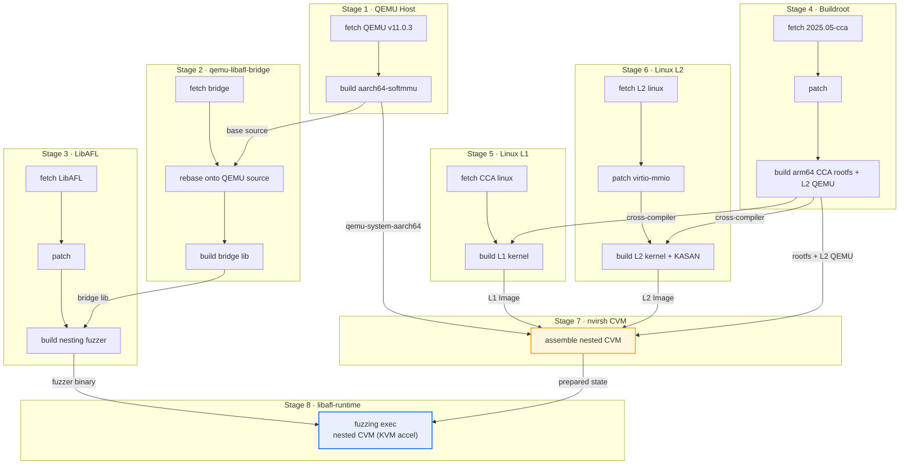

Since February, coding agents have dramatically accelerated my research progress, and I suspect many of you feel the same. Since February, I have cumulatively used 47.77 billion tokens during my postdoc at EPFL. As a postdoc, I run five or six projects at the same time and have trained myself to switch contexts quickly, but whenever I hit the kernel or a hypervisor, time still feels insufficient. Domain knowledge is just hard. With coding agents, the friction of learning domain knowledge has dropped a lot, but a new problem has emerged: how to keep results stable. So I built a workflow framework for system security, which also raised new requirements for my own programming. After stepping into countless pits, I can finally focus more on the novelty and impact of my projects, so I want to write something down and share the new paradigm of system security programming in the AI era. The workflow framework is open-sourced as Morpheus[^1]. The barrier to system security programming is lower, and the friction of doing system security research has shrunk as well. Below is a summary.

## Cognitive Offloading: Speak Your Intent

The root of prompt problems is cognitive offloading. A good prompt states clearly what to do, what counts as wrong, how to fix it, and when to stop. The more thoroughly you offload cognition, the more stable the model's execution becomes; the hard part is that we must first know what we want to do. In the AI era, human agency actually becomes more prominent, and the initial seeding problem is still our responsibility.[^2]

One-shot, few-shot, and prompt chaining are basic techniques. How long a prompt should be has always been debated. From my experience, stronger models need fewer prompts. When switching between open-source and frontier models, I also found that using one model to prompt another can bring improvements; even feeding a frontier model's trajectories to an open-source model works. Putting these prompts together gives you a skill.

Now about skills. Simply put, a skill is a collection of prompts. The key to writing a skill is distilling the workflow into a combination of written instructions and code glue. Stability first: we write the workflow down precisely to make it stable. Stability is one of the most important things in the era of large models; the other is the generation of insight. Only with stability can you produce reusable results. Some believe general-purpose LLMs will eventually internalize these workflows, and I don't deny it. But the stability of pure-text skills cannot be guaranteed, especially when a model's instruction following is weak: it may completely ignore your requirements, or follow them roughly while changing details to what it believes is correct. That is when you need to introduce code to add stability. Following this idea, I developed Morpheus, a workflow platform for system security with many tools built in. With it, we can write workflows directly through LLMs and complete system security development work.

Below is an example Morpheus workflow: `nvirsh-qemu-arm64-cvm-libafl-nesting-fuzzing`. The whole workflow is divided into 8 stages. The first 6 stages build the toolchain and the dual kernels in parallel, stage 7 assembles the nested CVM state, and stage 8 launches LibAFL nested fuzzing.



## Investigation and Validation: Keep Asking the Model Why

When it comes to development, the biggest problem with LLM programming is hallucination. The most practical fix is to add verification: investigation can be delegated to the LLM, but validation is on us. For example, while implementing page demote for the RMM, I found that all accesses went to offset 0, meaning the lower bits below 12 were not implemented. Limited by the attention span of LLMs, we can ensure software quality by reviewing requirement documents, summarizing with diffs, running code reviews, and completing unit and integration tests. Along the way I found that good system design and design models make review easier. Vibe coding changed how I program: from chatting with the LLM directly, to spec-driven programming, to more complex requirement, development, testing, and release processes. I have also tried TDD, which is a good practice.

Control the source of truth. LLMs are good at imitating examples. If one feature has two implementations, the extra one becomes noise and the model easily goes off the rails. So during review, make sure a feature has exactly one trusted implementation. A pit I stepped into: the seed wire format had two implementations; the producer and the consumer each maintained their own field layout, and only at runtime did I discover the two did not match. The length field written by the encoder was read by the decoder at a different offset, so the seed was configured but had no effect. The cause was that the context was not fully stated when modifying the code: I only asked the model to change the producer without telling it that the consumer had a separate field layout. Besides, explicit version numbers are another way to control the source of truth: they let the LLM know which state the current implementation, configuration, and experiment records are in.

Control regression. Regressions have troubled me a lot: the same bug keeps coming back. The countermeasure borrows from TDD: feature code must come with tests, and bug fixes must add tests to prevent regression. This has also been a long-standing challenge in software engineering.

Keep the human in the loop. Autoresearch in system security is not yet mature, so the human must stay in the loop. There are two reasons: today's LLMs have not covered all systems knowledge, and their investigation capability cannot yet be reliably dialed up and down, so we need to give guidance at critical moments. Therefore, system security people must retain their understanding of the system. Beyond that, you also need your own judgment on certain things. For example, when you are confident a feature is definitely implementable, you must push through even if the LLM balks.

## Long-Running Execution: Keep the Machines Busy

Long-running execution is a feature everyone dreams of, because it keeps machines running in the background. The most classic project is RalphLoop[^3], which is essentially a while loop. Later, different harnesses added commands like `/loop` and `/goal`, making long-running execution basically feasible. But long-running execution still poses considerable challenges, especially memory and context. Memory can be short-term or long-term, text or in-memory, and of course it also includes the memory in our own heads. My approach combines these techniques: write down key conclusions as text and have the LLM load them before running, to obtain a higher signal-to-noise ratio. I keep believing that when LLMs layer and construct context, they easily forget the goal and lose the focus. My current long-running projects last over ten hours, enough to cover a night; a friend runs RalphLoop on a weekly basis.

Single agent and multiple agents. In theory, as long as tokens and concurrency are unlimited, we would of course spin up many agents. The feeling of relentless grinding is reassuring; and if stability is sufficient, multiple agents can bring unexpected surprises, such as a sudden flash of insight on a problem, which perhaps comes from massive attempts. OpenAI's recent practice of solving the NS (Navier-Stokes) problem[^4] and Anthropic's practice of researching biological enzymes[^5] made me more interested in multi-agent setups. These problems share the same traits: insufficient general knowledge, many constraints, and no way to cheat—so does system security. Whether we can use hyper-scale agent swarms to obtain insight and solve hard problems in system security awaits more practice.

Mind the correctness of the scaffolding. Long-running execution depends on scaffolding, and there must be no bugs in the scaffolding. The logic is direct: wrong feedback is a disaster for some weaker models.

## Reflection and Evolution: Teach It to Dance in Shackles

Reflection improves agent performance. Our own experiments support this too. The recently discussed RSI (recursive self-improvement) turns what used to be human work of improving agents into part of the automation, which counts as an integration of the reflection mechanism. An interesting example is "AI-Driven Research for Systems" (ADRS)[^6], a program initiated by the Sky Computing Lab at UC Berkeley that aims to use AI to discover and optimize algorithms for real systems. Its biggest inspiration to me: metrics must be explicit, and iteration must be stable. I hope the future evolution of Morpheus can achieve this.

With AI, system security has become easier, but doing system security implementation well is still not a simple matter.

Next time I may write about how to find ideas.

[^1]: The workflow framework Morpheus: <https://github.com/cyruscyliu/Morpheus>

[^2]: For example, below is a long-running prompt (excerpt) that can be handed directly to a coding agent / Codex:

    ```text
    You are now in charge of a long-running seed debugging task: keep modifying and validating the seed until it truly triggers the CVE-2021-47352 virtio-net RX used-length vulnerability.

    Core reference document: tools/libafl/seeds/qemu_nesting/profiles/CVE-2021-47352/README.md
    Full validation command: ./evaluation/evaluation-0051-nvirsh-qemu-arm64-cvm-libafl-nesting-replay-cve-2021-47352.sh run

    Success criteria:
    1. The trace confirms that RX queue try_fill_recv/prefill has happened and the guest reaches the RX used-ring consumption path;
    2. The used-ring id/len is actually read and accepted by the virtio-net driver;
    3. The vulnerability-triggering warning defined in the README appears (e.g., Buffer overflow detected);
    4. `id 0 is not a head` is a failure state and must not be treated as success; workflow success only means the flow completed, not that the vulnerability was triggered.

    Important constraints:
    - Only advance by modifying seed parameters such as the seed's scenario input, WordModel, visit budget, and model order;
    - Do not modify the kernel, RMM, KVM, QEMU, or backing RAM; no host-side cheat, forged logs, or bypassing prefill;
    - Mind sub-word accesses: a u16 read at 0x2002 uses the aligned word 0x2000; to make the upper half-word read out used index 1, the word value should be 0x00010000, not 0x1.

    Each round:
    1. Read the seed, README, generation script, and the previous round's trace;
    2. Write out the single hypothesis for this round explicitly, and make only the minimal seed change;
    3. Assign a new explicit version number (v14, v15, ...), never overwrite old versions, and generate both the binary seed and the .txt rendering;
    4. Run the full evaluation, wait for it to finish, check fresh logs, and count claim/read offsets and key functions;
    5. Compare with the previous round and reflect once (which hypothesis was falsified, which trace proved the control flow, and what exactly to change in the next round), then write it into the versioned experiment record;
    6. Continue to the next round; do not stop at "looks reasonable" or "workflow success".

    Long-running requirements: keep working until the success criteria are met; each round must produce real file changes, real evaluation results, or new trace evidence; if the same hypothesis fails twice in a row, switch to another level; if there is no new evidence for three consecutive rounds, re-examine the decoder, the seed wire format, and the control flow. Final output: the successful seed version, key trace evidence, the original vulnerability warning text, reproduction steps, and why this is confirmed to be a genuine vulnerability trigger rather than model or log cheating.
    ```

[^3]: RalphLoop: <https://github.com/pageai-pro/ralph-loop>

[^4]: OpenAI: about 10,000 concurrent agents, results in 88 hours, 2.7 million agent messages, roughly 130 billion tokens, plus another 17 hours for Lean formalization. Official announcement: <https://openai.com/index/navier-stokes-solution/>

[^5]: Anthropic: Claude agents autonomously discovered ART, a novel enzyme system of unknown function (CRISPR-like repeat structures)—950 agents, 21 hours, 210 million tokens, scanning 1.9 billion metagenomic protein clusters. Official blog: <https://www.anthropic.com/news/claude-discovers-novel-enzyme-system/>

[^6]: ADRS ("AI-Driven Research for Systems"), Sky Computing Lab, UC Berkeley: <https://ucbskyadrs.github.io/blog/>
